# KNIGA

<p align="center">
  
</p>

**A social network for books.** Log what you read, rate it from half a star to five, review it, and keep a reading diary.
 Book data comes from [Open Library](https://openlibrary.org).


Team: Sh. Temuujin, T. Tsegts, S. Sukhbat
Design: Figma file *KNIGA - App Design*
Spec: *KNIGA - UML загварчлал* and *KNIGA - ERD*

---

## Quick start

You need **Node 23.6 or newer**. Nothing else: no database server, no API keys.

```bash
# 1. Get the code
git clone <repo-url> kniga
cd kniga

# 2. Install
npm install

# 3. Run (API on :3001, web app on :5173)
npm run dev
```

Then:

1. Open the URL Vite prints (usually http://localhost:5173).
2. Create an account.
3. In development no email is sent. Your **confirmation link is printed in the terminal** running the API. Open it to confirm.
4. Search for a book, log it, rate it, and check your profile at `/u/<username>`.

On first run the database is created at `data/kniga.db` and seeded with the 58-book starting catalog.

Want covers on the seeded books?

```bash
npm run covers
```

---

## Features

| Use case | What it does |
| --- | --- |
| UC-01 Sign up / log in | Sign up, log in with email or username, "keep me logged in", log out, email confirmation link |
| UC-02 Search books | Searches the catalog, falls back to Open Library and saves results, warns if the API is down |
| UC-05 Mark as read | Every log marks the book Read and removes it from Want to read |
| UC-06 Rate | Half-star ratings: click the left half of a star, or use the arrow keys |
| UC-07 Write a review | Review text with a spoiler flag |
| UC-08 Like | Heart a book from the log form or the book page |
| UC-09 Tags | Lowercased, de-duplicated, with suggestions from tags you used before |
| UC-10 Want to read | Toggle on the book page |
| Diary | Letterboxd-style diary grouped by month, edit and delete entries, filter by year |
| Recent Logs | Home page shows your 10 latest entries, 4 at a time, horizontally scrollable |
| Profile | `/u/:username` with stats, editable bio, Top 4 favourite books (drag, arrows, or pick from search), recent activity, recent reviews with spoiler guard, ratings spread, tags |

### Not built yet

- Lists
- Review likes and comments
- Following
- Critic verification
- Patron covers
- Password reset
- Google sign-in

---

## Commands

| Command | What it does |
| --- | --- |
| `npm run dev` | API on :3001 and web app on :5173 (Vite picks the next free port if 5173 is taken) |
| `npm test` | API tests (auth and log entries) |
| `npm run typecheck` | TypeScript check |
| `npm run covers` | Fetch covers for catalog books that have none (Open Library, no API key) |
| `npm run build && npm start` | Production: one server on :3001 serves the API and the built app |

## Configuration

All optional.

| Variable | Default | Purpose |
| --- | --- | --- |
| `PORT` | `3001` | API port |
| `DATABASE_PATH` | `data/kniga.db` | SQLite file location |
| `APP_URL` | `http://localhost:5173` | Base URL used in email links |

---

## How it is built

| Layer | Tech |
| --- | --- |
| Frontend | React 18, TypeScript, Vite, React Router. Styles in `src/styles.css` use the same tokens as Figma (cream/linen base, beige accents, sky blue, light navy grey) |
| Backend | Express and `node:sqlite`, TypeScript run directly by Node. Code in `server/` |
| Data | Open Library for book metadata and covers |

### Security

- Passwords hashed with scrypt
- Random session tokens, stored hashed in the database
- HttpOnly, SameSite=Lax cookies
- Login rate limiting and generic "incorrect email/username or password" errors
- State-changing requests must be JSON, which blocks cross-site form posts

### Database

Tables follow the ERD: `users`, `books`, `log_entries`, `tags`, `entry_tags`. Extra tables and columns the use cases need:

| Addition | Why |
| --- | --- |
| `sessions`, `email_verifications` | Sign-up and login (UC-01) |
| `user_books` | Read without an entry, heart, and Want to read (UC-05 1a, UC-08, UC-10). The ERD had no table for these |
| `log_entries.liked` | The heart toggle on each log |
| `favorite_books` | The profile's Top 4, one row per filled slot |
| `books.description`, `books.page_count` | Shown on the book page (UC-03) |

**Rating rule:** each log entry can carry a rating. A reader's *active* rating for a book is the one on their most recent rated entry, so averages count one rating per reader, as the UML requires.

---

## Repo layout

```
kniga/
  server/    API: auth.ts, books.ts, logs.ts, users.ts, db.ts, seed-books.ts, plus tests
  src/       React app: pages/, components/, styles.css
  scripts/   kniga_book.py: the animated ASCII book (plays in the terminal, or rebuilds docs/kniga-book.svg with --svg)
  design/    original profile-page design export (reference only, excluded from GitHub language stats)
  data/      SQLite database, created on first run
```
